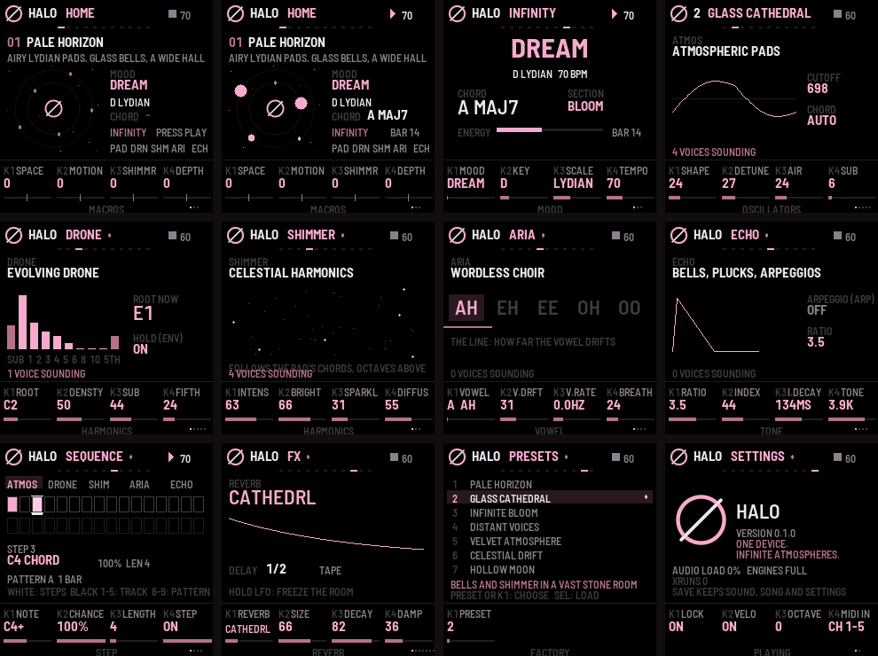

# HALO

**An ambient workstation firmware for the M-VAVE FM-1.** *One device. Infinite atmospheres.*



HALO turns the FM-1 into an instrument for ambient music. It has five sound engines on five tracks:

* **ATMOS:** evolving pads
* **DRONE:** a living, breathing bed
* **SHIMMER:** celestial upper harmonics
* **ARIA:** a wordless formant choir
* **ECHO:** bells, plucks and arpeggios

Around them sit a probability step sequencer with a voice-leading chord generator and harmonic drift, a reverb,
delay and modulation section, four performance macros (SPACE, MOTION, SHIMMER, DEPTH), and **INFINITY**: press PLAY
and it composes, forever, in one of seven moods.

> **Status 0.1.0: tested in simulation only.** HALO builds and passes all its tests in fm1-base's host simulator, and
> its CPU load is estimated at about 47% typical and 59% worst case. It has not yet been compiled for the FM-1's CPU
> or run on an FM-1. Read [docs/TESTING.md](docs/TESTING.md) and [docs/DEPLOY.md](docs/DEPLOY.md) before installing.

## Quick start

1. Turn **PRESET** to choose one of 20 atmospheres. Press **PLAY**.
2. Turn **K1–K4** (SPACE, MOTION, SHIMMER, DEPTH). Play the keys. Hold **LFO** to freeze the room.
3. **EDIT** steps through the engines, **SEQ** opens the sequencer, **GLO** opens INFINITY. See
   [docs/MANUAL.md](docs/MANUAL.md).

## Repository

| Path | What |
|---|---|
| `firmware/app.c`, `app.h` | the UI: 11 pages on the 240×240 screen, keys, encoders, MIDI, saving, backup |
| `firmware/dsp/halo_dsp.c` | the engines, the mixer and the effects (float32, compiled at -O2) |
| `firmware/dsp/halo_comp.c` | the clock, sequencer, chord generator, arpeggiator and INFINITY |
| `firmware/dsp/halo_params.*` | every parameter, its range and display, and the 20 factory presets |
| `firmware/tests/` | simulator scripts, audio analysis, the CPU estimate |
| `base/` | [fm1-base](https://github.com/charlesvestal/fm1-base) (a submodule, MPL-2.0) on [felucca-bsp](https://github.com/hugelton/felucca-bsp) |
| `docs/` | [architecture and hardware verification](docs/ARCHITECTURE.md), [manual](docs/MANUAL.md), [presets](docs/PRESETS.md), [testing](docs/TESTING.md), [deployment](docs/DEPLOY.md) |

```
./build.sh --host && firmware/tests/run_tests.sh   # simulator + tests, any Linux or macOS machine
./build.sh                                         # the FM-1 package (JieLi toolchain; or GitHub Actions)
```

## Credits and licence

HALO's own code is MPL-2.0. It is built on fm1-base by Charles Vestal and felucca-bsp by Leo Kuroshita (Hügelton
Instruments), both MPL-2.0; their notices are in `base/`. The CPU calibration uses Felucca-Engines (MIT), fetched by
the benchmark, not included. HALO is not affiliated with or endorsed by M-VAVE. Installing custom firmware is at your
own risk.
